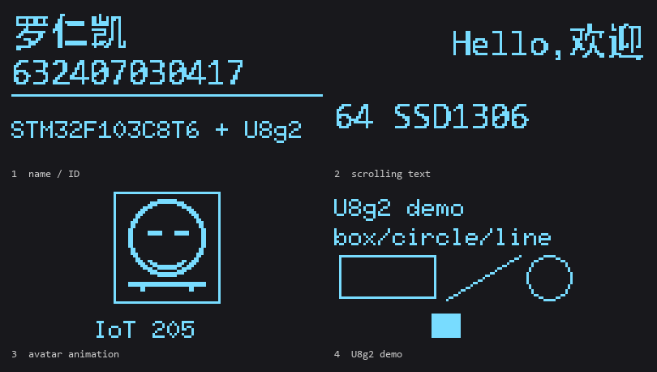

# 任务三：U8g2 移植到 STM32F103 + 0.96" OLED

这是**任务三**的工程，和任务一那个工程（`F:\deepseek_work\OLED_U8G2`）是**两份独立工程**，
互不影响。任务一那份用的是自己写的 SSD1306 驱动，这份用的是 U8g2。



## 一、打开与编译

1. 双击 `MDK-ARM\OLED_U8G2.uvprojx`（或先开 Keil 再 File → Open Project）
2. `F7` 编译：应该 0 Error / 0 Warning
3. 接 ST-Link，`F8` 下载

接线和任务一完全一样：OLED `VCC→3.3V`、`GND→GND`、`SCL→PB6`、`SDA→PB7`。

## 二、四屏内容（每 5 秒切换）

| 屏 | 内容 |
|---|---|
| 1 | 姓名「罗仁凯」+ 学号 + `STM32F103C8T6 + U8g2` |
| 2 | 长句左右滚动（中文句 + 英文行反向） |
| 3 | 头像图案 + 上下浮动 / 眨眼动画 |
| 4 | U8g2 demo：`u8g2_font_6x10_tf` 文本 + 矩形 / 圆 / 直线 + 移动方块 |

## 三、U8g2 是怎么移植的

```
U8G2/csrc/            u8g2 官方源码（只把用到的文件加进工程）
U8g2App/Src/u8g2_port.c   ← 移植层：字节传输回调 + 延时回调
U8g2App/Src/app_u8g2.c    ← 应用层：四屏逻辑
U8g2App/Src/xbm_font.c    ← 中文字模（16x16，XBM 格式）
```

移植的核心就是两个回调：

```c
u8g2_Setup_ssd1306_i2c_128x64_noname_f(&u8g2, U8G2_R0,
                                       u8x8_byte_stm32_hw_i2c,
                                       u8x8_gpio_and_delay_stm32);
```

- `u8x8_byte_stm32_hw_i2c()`：u8g2 在 START_TRANSFER 和 END_TRANSFER 之间把数据分几次丢过来，
  这里攒进缓冲区，结束时一次性通过 I2C 发给 0x78；
- `u8x8_gpio_and_delay_stm32()`：把 u8g2 的延时消息映射到 `HAL_Delay()`。

## 四、针对 F103C8 做的裁剪（重点）

F103C8 只有 **64 KB Flash**，而 u8g2 官方源码直接编进来是几百 KB，必须裁剪：

| 原始文件 | 大小 | 处理 |
|---|---|---|
| `u8g2_fonts.c` | 30 MB（所有字库） | 只保留 `u8g2_font_6x10_tf` 一个字体 → `u8g2_fonts_min.c`（2 KB） |
| `u8g2_d_setup.c` | 259 KB（所有屏幕的初始化函数） | 只保留 `u8g2_Setup_ssd1306_i2c_128x64_noname_f` → `u8g2_d_setup_min.c` |
| `u8g2_d_memory.c` | 24 KB（所有尺寸的显存缓冲） | 只保留 128×64 的 1024 字节缓冲 → `u8g2_d_memory_min.c` |
| 其余 .c | — | 只把用到的 23 个文件加进工程（不用的控制器驱动全部不加） |

**中文为什么不用 u8g2 的 wqy 字库？**
`u8g2_font_wqy16_t_gb2312` 一个文件就 318 KB，`chinese1` 精简版也要 14 KB，
F103C8 装不下。这里用 16×16 点阵字模（22 个字 = 704 字节），
通过 `u8g2_DrawXBMP()` 画出来，效果与字库方式一致。

**为什么用软件 I2C 而不是硬件 I2C？**
MDK-Lite 有 32 KB 代码上限。实测：U8g2 + 硬件 I2C 编译出来 **40.8 KB**（超限），
去掉 `stm32f1xx_hal_i2c.c`（约 14 KB）改用 GPIO 模拟 I2C 后是 **24.7 KB**。
两者协议完全一样，只是时钟由 GPIO 翻转产生。

## 五、文件说明

| 文件 | 作用 |
|---|---|
| `U8G2/csrc/*` | u8g2 官方源码（已裁剪，见上表） |
| `U8G2/csrc/u8g2_fonts_min.c` | 裁剪后的字库 |
| `U8G2/csrc/extract_font.py` | 生成 `u8g2_fonts_min.c` 的脚本 |
| `U8G2/csrc/trim_setup.py` | 生成 `*_min.c` 的脚本 |
| `U8g2App/Src/u8g2_port.c` | 软件 I2C + u8g2 回调 |
| `U8g2App/Src/app_u8g2.c` | 四屏应用 |
| `U8g2App/Src/xbm_font.c` | 中文字模与头像位图 |
| `Core/Src/main.c` | 72 MHz 时钟 + 调用 u8g2 应用 |
| `host_t3/` | PC 端验证（把 I2C 数据喂给显存模型出图），不参与 Keil 编译 |

## 六、已验证 / 未验证

- ✅ 用 Keil 自带的 ARMCC 5 编译链接通过：0 Error，**24.7 KB**（Code 21.5 KB + RO 3.7 KB）
- ✅ 在 PC 上用显存模型跑出四屏画面（即上面那张图），逐像素检查
- ❌ 还没在真机上跑（需要你 F7 + F8 验证）
